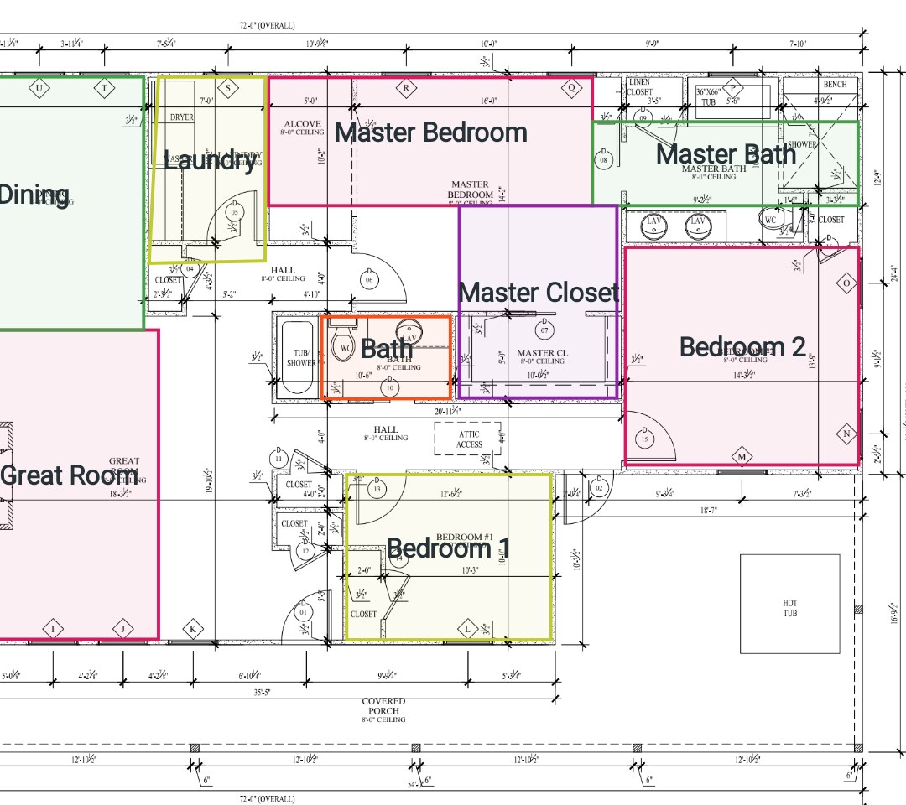

<p align="center">
  
</p>

<h1 align="center">Blueprint+</h1>

<p align="center">
  <strong>Cabinet takeoffs from a PDF plan, on your phone.</strong><br />
  Set the scale, tap two points per run, and get linear footage by room.
</p>

<p align="center">
  <a href="https://github.com/lukeadair/blueprint-plus/releases/latest"></a>
  
  
  
</p>

<p align="center">
  
</p>

Blueprint+ is an Android takeoff tool for cabinet quotes. Open a PDF floor plan, set the drawing
scale (usually 1/4" = 1'), and measure cabinet runs by tapping two points. It totals the linear
footage per room and for the whole job. Everything stays on the phone.

## What it does

**Precise points.** Tap to open a magnifier with crosshairs, then drag the handle to place each point.

**Any scale.** Type the scale, or calibrate from a known dimension for plans printed "fit to page".

**Rooms.** Room names are read from the plan's own text (Android 15+, PDFs with real text), and room borders are found from the walls. Drag corners, add rooms, or Redetect.

**Totals.** The run list is grouped by room with footage totals. Drag runs between rooms; add, rename and delete rooms.

**Saved automatically.** Every change is saved as you go. Nothing is lost on back or kill.

## Install


Download the APK from the [latest release](../../releases/latest) and open it on an Android
8.0+ phone (allow installs from your browser or file manager when asked).

## Build

Needs the JDK bundled with Android Studio:

```sh
export JAVA_HOME="/Applications/Android Studio.app/Contents/jbr/Contents/Home"
./gradlew testDebugUnitTest
./gradlew assembleDebug
```

`./gradlew assembleRelease` signs the APK when a git-ignored `keystore.properties` points to a key
(`storeFile`, `storePassword`, `keyAlias`, `keyPassword`); without it the release APK is unsigned.

## License

MIT
